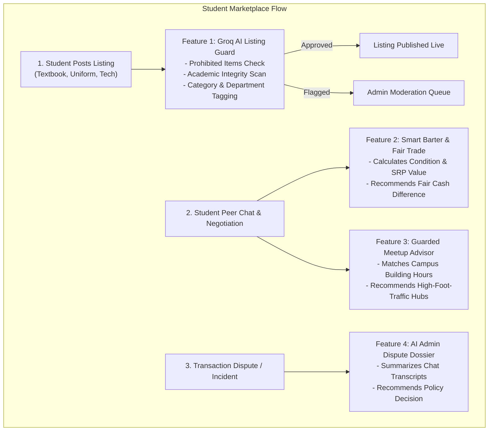
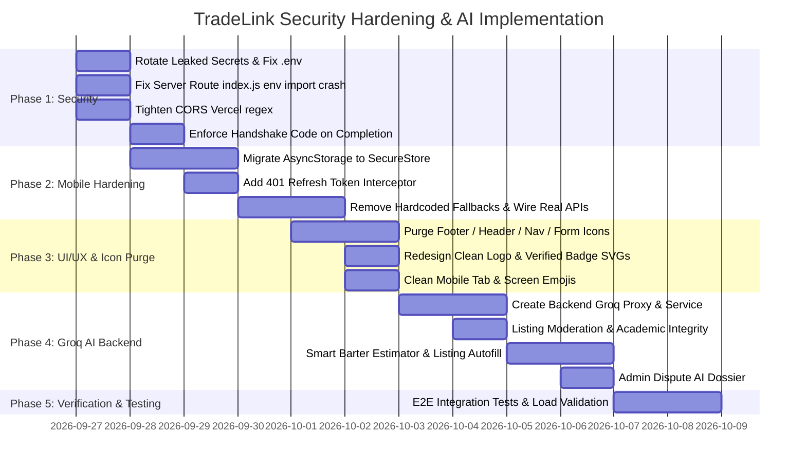

# TradeLink Master System Plan: Security Architecture, UI/UX Simplification & Groq AI Integration

**Target Environment:** University of Cebu Campus Network (`uc-tradelink`)  
**Audited Platforms:** Server (Node.js/Express/Knex), Client Web (React 19/Vite), Mobile (React Native/Expo), Admin Portal  
**AI Engine:** Groq API (`llama-3.3-70b-versatile`) via Secure Backend Proxy  

---

## 1. Executive Summary & Audit Findings

An exhaustive security and architectural audit was performed across all directories of TradeLink (`server`, `client`, `mobile`, `admin`, `DB`). While the foundation has strong components (Helmet, Bcrypt, Knex parameterized queries, JWT token versioning), several **critical security vulnerabilities**, **UI/UX icon clutter anti-patterns**, and **mobile implementation gaps** require immediate resolution.

---

## 2. Comprehensive Security & Risk Audit

### 🚨 Critical Severity Risks

| ID | Component | Vulnerability / Risk | Attack Vector / Impact | Remediation Plan |
|---|---|---|---|---|
| **SEC-01** | `server/src/routes/index.js` | **Server Crash Bug (`ReferenceError: env is not defined`)** | Line 32 in `routes/index.js` accesses `env.env` in `/health` route, but `const env = require('../config/env');` is **not imported**. Calling `GET /api/health` immediately crashes the request handler with a 500 error. | Import `env` at top of `routes/index.js` and add a regression test. |
| **SEC-02** | `server/.env` & Git History | **Exposed Production Secrets & Credentials** | Plaintext TiDB Cloud connection URI, passwords, JWT secrets, Gmail SMTP App Password (redacted), Cloudinary API secret, and Groq API Key entered in chat. | 1. Immediately rotate all leaked keys (TiDB, Gmail, Cloudinary, Groq).<br/>2. Add automated secret scanning (`git-secrets` / pre-commit).<br/>3. Verify `.env` is permanently removed from git cache. |
| **SEC-03** | `server/src/config/cors.js` | **Permissive Vercel Preview CORS Wildcard** | Regex `/^https:\/\/[a-z0-9-]+.*\.vercel\.app$/i` allows **any** malicious third-party site hosted on Vercel to bypass CORS and make credentialed requests (`credentials: true`) to TradeLink API. | Restrict preview matching strictly to your team's project slug: `/^https:\/\/tradelink-[a-z0-9-]+-drib14\.vercel\.app$/i`. |

---

### ⚠️ High Severity Risks

| ID | Component | Vulnerability / Risk | Attack Vector / Impact | Remediation Plan |
|---|---|---|---|---|
| **SEC-04** | `mobile/user/services/api.ts` | **Insecure Token Storage (`AsyncStorage`)** | Mobile JWT access tokens are stored in unencrypted `AsyncStorage` (unencrypted SQLite database on Android). Physical extraction or root exploit compromises session. | Migrate token persistence to hardware-backed secure storage using `expo-secure-store` with Keychain (iOS) and Keystore (Android). |
| **SEC-05** | `mobile/user/services/api.ts` | **Missing Token Refresh Interceptor on Mobile** | Mobile API client does not handle 401 token expiration. Since access tokens expire in 15 minutes (`JWT_ACCESS_EXPIRY=15m`), mobile users are abruptly broken and cannot make requests after 15 min. | Implement automatic refresh token rotation queue in `mobileRequest` with retry on 401. |
| **SEC-06** | `mobile/user/services/auth.service.ts` | **Hardcoded Default Credentials** | Default passwords (`password: password || 'default123'`, `payload.password || 'Student@123'`) are hardcoded into login and registration payloads. | Remove all fallback default passwords. Enforce mandatory user input and client-side password strength validation. |
| **SEC-07** | `mobile/user/app/item/[id].tsx` | **Mocked / Disconnected Transaction Creation** | Buying, claiming, and swapping on mobile only trigger local `Alert.alert(...)`. No HTTP request is sent to `/api/transactions` or `/api/swaps`. | Wire mobile buttons to real `mobileApi.post('/transactions')` and `mobileApi.post('/swaps')` with error handling. |
| **SEC-08** | `server/src/controllers/transactions.controller.js` | **Missing Handshake Code Verification on Completion** | While docs describe a 4-digit bcrypt-hashed handshake code, `completeTransaction` allows the seller to mark complete without validating a buyer verification handshake code. | Enforce one-time 4-digit code verification (`verifyCode(buyerCode, tx.verification_code_hash)`) before transitioning status to `completed`. |
| **SEC-09** | `server/src/controllers/auth.controller.js` | **Password Reset Dev Code Leak in Non-Prod** | Line 345 returns `resPayload.devCode = code;` whenever `NODE_ENV !== 'production'`. If staging or cloud dev is deployed, anyone knowing an email can reset accounts. | Enforce that `devCode` is NEVER returned over HTTP; log only to secure backend server console in local development. |

---

### ℹ️ Medium & Low Severity Risks

| ID | Component | Vulnerability / Risk | Remediation Plan |
|---|---|---|---|
| **SEC-10** | `mobile/user/app/(tabs)/wanted.tsx` | **Hardcoded Fallback User Account** | Uses fallback `user-alex` / `Alex Rivera` if unauthenticated instead of prompting login. Require authentication before posting. |
| **SEC-11** | `mobile/user/app/(tabs)/messages.tsx` | **Mock In-Memory Chat** | Mobile messages screen uses static mock array instead of connecting to `socket.io` and REST `/api/chat/conversations`. Connect real WebSocket listener. |
| **SEC-12** | `server/src/socket/index.js` | **Serverless WebSocket Incompatibility** | Vercel Serverless Functions do not maintain persistent WebSocket connections. Document and enforce that the Node.js backend must run on Render / Railway / persistent VPS. |

---

## 3. UI/UX Simplification & Icon De-Cluttering Plan

### Objective
Transform TradeLink from an over-decorated, AI-generated appearance into a **clean, authoritative, premium academic platform** inspired by modern design leaders (Linear, Apple, Stripe, Vercel).

### The Icon Purge Guidelines
1. **Rule of Utility**: Icons must ONLY exist where they communicate distinct functional state (e.g., search magnifier inside input, chevron in dropdown, verified checkmark on trust badge).
2. **Eliminate Redundant Inline Icons**: Do not put icons next to self-explanatory text labels (e.g. `HelpCircle` next to "FAQ", `Info` next to "About", `DollarSign` next to "Price", `MapPin` next to "Location").
3. **No Emojis in Core UI Elements**: Remove all emojis (`⚡`, `📦`, `💵`, `🎓`, `🤝`) from buttons, headers, category chips, and tab titles. Emojis belong in student chat messages, not in interface components.

---

### Screen-by-Screen Remediation

#### 1. Footer (`client/src/components/layout/Footer.tsx`)
- ❌ **Current**: Every link has an icon: `<HelpCircle /> FAQ`, `<Info /> About`, `<Shield /> Safety`, `<FileText /> Terms`, `<Users /> Developers`.
- ✅ **New**: Pure typography navigation row. Crisp text with subtle hover color transition (`#CBD5E1` → `#FFFFFF`). No icons.

#### 2. Navbar (`client/src/components/layout/Navbar.tsx`)
- ❌ **Current**: Overcrowded buttons with duplicate icons and heavy borders.
- ✅ **New**: Restrained, modern bar: clean typography logo, clean search input with single search icon, minimal action icons (Notification bell, Chat bubble, User Avatar).

#### 3. Brand Identity & Logo (`TradeLinkIcon.tsx` / `TradeLinkLogo.tsx`)
- ❌ **Current**: Complex squircle with glowing "nexus dot" and stylized interlocking lines (typical AI vector generator output).
- ✅ **New**: Sleek academic monogram or clean geometric shield emblem with solid University of Cebu Blue (`#002B7F`) and Gold accent (`#FFC72C`). Crisp at 16px, 24px, 32px, and 128px without visual noise.

#### 4. Verified Student Badge (`client/src/components/common/VerifiedBadge.tsx`)
- ❌ **Current**: 24-petal scalloped multi-layer rosette with heavy drop-shadows.
- ✅ **New**: Clean, modern circular badge with centered checkmark (16px/18px geometric circle with crisp white checkmark), subtle tooltip, zero gaudy gradients.

#### 5. Mobile Navigation & Tabs (`mobile/user/app/(tabs)/_layout.tsx`)
- ❌ **Current**: Tab labeled `⚡ Flash` with both emoji and vector icon.
- ✅ **New**: Clean label `Flash` with standard Ionicons outline/fill state. Consistent stroke width across all 5 tabs.

#### 6. Filter Bar (`client/src/components/marketplace/FilterBar.tsx`)
- ❌ **Current**: Redundant icons inside select menus and filter toggles.
- ✅ **New**: Streamlined pill filters: Category chips with clean text, native minimal selects for Campus, Trade Mode, and Condition.

#### 7. Safety, About & FAQ Pages
- ❌ **Current**: Icon inside every sub-heading, checklist item, and guideline card (`Sparkles`, `Clock`, `Eye`, `ThumbsUp`, `Camera`).
- ✅ **New**: Clean editorial typography with structured whitespace, standard numerical lists, and subtle border dividers.

---

## 4. AI Features Integration Plan (Groq `llama-3.3-70b-versatile`)

### Architecture Principle: Zero Client-Side Exposure
The provided Groq credentials must reside **strictly on the backend**:
```
Client / Mobile App  ──(JWT Authenticated HTTPS)──>  TradeLink API  ──(Groq SDK / REST)──>  Groq API (Llama 3.3 70B)
```
- **Never expose `GROQ_API_KEY` in frontend `.env` or React Native bundles.**
- Rate-limit all AI endpoints to prevent quota exhaustion and abuse.
- Cache common requests (e.g. book catalog lookups) in database.

---

### Selected High-Value AI Features for TradeLink



### Feature Specifications

#### Feature 1: AI Campus Guard & Academic Integrity Inspector
- **Endpoint**: `POST /api/ai/moderate-listing` (Internal trigger on `POST /api/listings`)
- **Model**: `llama-3.3-70b-versatile`
- **Function**:
  - Scans title, description, and tags for:
    - Academic dishonesty materials (leaked midterm exams, answer keys, test banks).
    - Prohibited campus items (vapes, alcohol, controlled gear, counterfeit items).
  - Automatically predicts correct College/Department (`CCS`, `CBA`, `Nursing`, `Maritime`, `Engineering`) and standard category.
- **Latency**: ~300ms on Groq LPUs.
- **Output**: Structured JSON:
  ```json
  {
    "isApproved": true,
    "confidenceScore": 0.98,
    "riskLevel": "none",
    "suggestedDepartment": "College of Computer Studies",
    "suggestedCategory": "Textbooks",
    "flagReason": null
  }
  ```

#### Feature 2: Smart Barter & Fair-Trade Valuation Assistant
- **Endpoint**: `POST /api/ai/estimate-barter`
- **Location**: Swap Proposal Modal (`SwapProposalModal.tsx`) & Mobile Item Detail.
- **Function**:
  - Compares Target Item vs Offered Swap Item (item models, condition grades, original SRP).
  - Calculates whether the barter is equitable or suggests a reasonable cash top-up (e.g. "Item A is valued at ~₱800, Item B is ~₱600. A cash top-up of ₱200 makes this a balanced trade.").
- **Value**: Removes awkward negotiation friction and prevents students from getting ripped off.

#### Feature 3: Smart Listing Auto-Fill (Textbooks & Lab Supplies)
- **Endpoint**: `POST /api/ai/autofill-listing`
- **Location**: `CreateListingPage.tsx` and mobile `create-listing.tsx`.
- **Function**:
  - Student enters book title, ISBN, or subject code (e.g. "Campbell Biology 11th edition" or "DC Circuits Reviewer").
  - AI generates a concise, accurate description, table of contents highlights, estimated original SRP in Philippine Pesos (₱), and applicable UC college courses.

#### Feature 4: Guarded Campus Meetup & Time Advisor
- **Endpoint**: `POST /api/ai/suggest-meetup`
- **Location**: Chat Deal Card & Scheduling Modal.
- **Function**:
  - Based on the two students' campus affiliations and current time, suggests the safest guarded meetup spot within operating hours (e.g., "UC Banilad Atrium Ground Floor — open until 6:00 PM; security personnel on duty").

#### Feature 5: AI Dispute Summarizer for Moderators
- **Endpoint**: `GET /api/admin/disputes/:id/ai-summary`
- **Location**: Admin Portal Dispute Resolution Desk (`admin/src/pages/AdminDashboard.tsx`).
- **Function**:
  - Reads chronological chat history and transaction details.
  - Summarizes the dispute in 3 bullet points: (1) Agreed deal, (2) Alleged issue (e.g. no-show or undisclosed damage), (3) Recommended moderator action based on TradeLink Community Guidelines.

---

## 5. Step-by-Step Implementation Roadmap



### Detailed Execution Tasks

#### Task 1: Backend Security Hotfixes
1. **Fix `server/src/routes/index.js`**: Add `const env = require('../config/env');` at top.
2. **Patch CORS in `server/src/config/cors.js`**: Replace greedy Vercel regex with exact project prefix.
3. **Enforce Handshake Code in `server/src/controllers/transactions.controller.js`**:
   - Require `handshakeCode` parameter in `completeTransaction`.
   - Validate against `tx.verification_code_hash` using `verifyCode()`.
   - Add rate limiter on attempts (maximum 3 failed verification attempts before 15-minute freeze).
4. **Remove `devCode` Leak**: In `server/src/controllers/auth.controller.js`, never pass `devCode` in HTTP response body under any environment flag.

#### Task 2: Mobile Security & API Wiring
1. **Install and Configure `expo-secure-store`**:
   - Replace unencrypted `AsyncStorage.setItem('tradelink_mobile_token')` with `SecureStore.setItemAsync('tradelink_access_token')` and `SecureStore.setItemAsync('tradelink_refresh_token')`.
2. **Implement Refresh Token Rotation in `mobile/user/services/api.ts`**:
   - If response status is 401, pause pending requests, call `POST /api/auth/refresh-token`, update stored tokens, and replay original request.
3. **Eliminate Hardcoded Demo Values**:
   - Remove `password: password || 'default123'` in `auth.service.ts`.
   - Remove `requesterId: 'user-alex'` fallback in `wanted.tsx`.
   - Wire `[id].tsx` buy/swap buttons to real `mobileApi.post('/transactions')` and `mobileApi.post('/swaps')`.

#### Task 3: UI/UX De-Cluttering & Icon Purge
1. **Footer Clean-up**:
   - Strip all Lucide icon tags (`HelpCircle`, `Info`, `Shield`, `FileText`, `Users`) from `client/src/components/layout/Footer.tsx`.
2. **Purge Emojis**:
   - Remove emojis from `ProfilePage.tsx` (`💵 Cash on Meetup` → `Cash on Meetup`), `CreateListingPage.tsx`, `BuyNowModal.tsx`.
   - Remove `⚡` from mobile tab title `wanted` (`⚡ Flash` → `Flash`).
   - Remove `📦` from mobile chat item line (`📦 {item.title}` → `{item.title}`).
3. **Brand & Verified Badge Modernization**:
   - Replace complex AI squircle in `TradeLinkIcon.tsx` and `TradeLinkLogo.tsx` with clean University of Cebu academic monogram mark.
   - Replace multi-lobed rosette in `VerifiedBadge.tsx` with a refined 16px geometric checkmark disc.
4. **Filter & Header Simplification**:
   - Remove redundant icons (`Tag`, `Building2`, `DollarSign`) inside `FilterBar.tsx` selects.

#### Task 4: Secure Groq AI Service Implementation
1. **Install Groq SDK on Server**:
   ```bash
   cd server && npm install groq-sdk
   ```
2. **Configure Backend Environment Variables (`server/.env`)**:
   ```env
   GROQ_API_KEY=your_groq_api_key_here
   GROQ_MODEL=llama-3.3-70b-versatile
   GROQ_BASE_URL=https://api.groq.com/openai/v1
   ```
3. **Build `server/src/services/ai.service.js`**:
   - Initialize Groq client with timeout and retry controls.
   - Implement helper methods:
     - `moderateListing(title, description, category)`
     - `estimateBarterFairness(itemA, itemB)`
     - `autofillListingDetails(inputPrompt)`
     - `summarizeDispute(conversationMessages, transactionInfo)`
4. **Build Route Controllers**:
   - `server/src/routes/ai.routes.js` protected with `authenticate` and dedicated rate limiters (`aiLimiter`).
5. **Frontend & Mobile UI Connections**:
   - Add "AI Auto-Complete" button on `CreateListingPage.tsx`.
   - Add "Fair Trade Analysis" badge in `SwapProposalModal.tsx`.
   - Add "AI Summary" card in `AdminDashboard.tsx` for dispute resolution.

---

## 6. Success Metrics & Verification Checklist

- [ ] `GET /api/health` returns HTTP 200 without reference errors.
- [ ] CORS rejects non-whitelisted Vercel subdomains.
- [ ] Mobile app securely stores tokens in Keychain/Keystore via `expo-secure-store`.
- [ ] Mobile app transparently refreshes expired 15-minute tokens without logging the student out.
- [ ] Mobile buy and swap buttons create authentic database records and emit Socket.IO events.
- [ ] In-person transaction completion requires the authentic 4-digit handshake code.
- [ ] UI footer, tabs, dropdowns, and buttons have zero unnecessary icons or hardcoded emojis.
- [ ] Groq AI accurately classifies test listings for prohibited academic dishonesty items in < 500ms.
- [ ] Groq API Key is 100% inaccessible to frontend and mobile code bundles.
