# TradeLink Detailed Process Flow

TradeLink is a verified University of Cebu student marketplace supporting buying, selling, swaps, guarded meetups, messaging, reviews, and administrative moderation.

## End-to-end platform flow

```mermaid
flowchart TD
    START([Student opens TradeLink]) --> APP[React client loads MainApp]
    APP --> SESSION{Access token available?}
    SESSION -->|No| PUBLIC[Public home, marketplace, FAQ, safety, campus map]
    SESSION -->|Yes| RESTORE[AuthContext calls GET /api/auth/me]
    RESTORE --> VALID_TOKEN{Token valid and account active?}
    VALID_TOKEN -->|No| CLEAR[Clear session and show login]
    VALID_TOKEN -->|Yes| ROLE[Load user role, campus, verification, and trust data]
    CLEAR --> PUBLIC
    ROLE --> ROUTE{Requested area}
    PUBLIC --> AUTH{User wants a protected action?}
    AUTH -->|No| BROWSE
    AUTH -->|Yes| LOGIN

    subgraph AUTHENTICATION[Authentication and account lifecycle]
        LOGIN[Enter email or Student ID and password] --> LOGIN_REQ[POST /api/auth/login]
        LOGIN_REQ --> SECURITY[Helmet, CORS, sanitization, HPP, rate limit]
        SECURITY --> CREDENTIALS{Credentials valid?}
        CREDENTIALS -->|No| LOGIN_ERROR[Show login error]
        CREDENTIALS -->|Yes| TOKENS[Issue short-lived access token and rotating refresh cookie]
        TOKENS --> AUTH_STATE[Store authenticated user in AuthContext]
        AUTH_STATE --> ROUTE
        LOGIN_ERROR --> LOGIN
        PUBLIC --> REGISTER_CHOICE{Register or sign in?}
        REGISTER_CHOICE -->|Sign in| LOGIN
        REGISTER_CHOICE -->|Register| REGISTER[Submit name, UC email, Student ID, campus, college, year, password]
        REGISTER --> REGISTER_REQ[POST /api/auth/register]
        REGISTER_REQ --> REG_VALID{Input valid and account unique?}
        REG_VALID -->|No| REG_ERROR[Show validation or duplicate-account error]
        REG_VALID -->|Yes| HASH[Hash password with bcrypt]
        HASH --> USER_CREATE[(Create student in users table)]
        USER_CREATE --> PENDING[Account created as unverified or pending verification]
        PENDING --> VERIFY_START
        REG_ERROR --> REGISTER
        AUTH_STATE --> FORGOT_CHOICE{Forgot password?}
        FORGOT_CHOICE -->|Yes| RESET_REQ[Request reset code]
        RESET_REQ --> RESET_CODE[POST /api/auth/forgot-password]
        RESET_CODE --> RESET_VERIFY[Verify 4-digit code and expiration]
        RESET_VERIFY -->|Valid| PASSWORD[POST /api/auth/reset-password and hash new password]
        RESET_VERIFY -->|Invalid| RESET_ERROR[Reject reset attempt]
        PASSWORD --> LOGIN
        RESET_ERROR --> RESET_CODE
    end

    subgraph VERIFICATION[Student verification]
        VERIFY_START[Open student verification modal] --> ID_UPLOAD[Upload student ID and optional live selfie]
        ID_UPLOAD --> VERIFY_REQ[POST /api/users/me/verify-id]
        VERIFY_REQ --> REVIEW_QUEUE[(Store submission and mark verification pending)]
        REVIEW_QUEUE --> ADMIN_REVIEW[Admin reviews ID submission]
        ADMIN_REVIEW --> ID_DECISION{Identity evidence acceptable?}
        ID_DECISION -->|No| REJECT_ID[Reject submission and notify student]
        ID_DECISION -->|Yes| APPROVE_ID[Approve badge and increase trust score]
        REJECT_ID --> VERIFY_START
        APPROVE_ID --> VERIFIED[User is verified]
    end

    subgraph DISCOVERY[Marketplace discovery]
        BROWSE[Open marketplace or home feed] --> FILTERS[Select campus, category, condition, mode, search, price, sorting]
        FILTERS --> LIST_REQ[GET /api/listings]
        LIST_REQ --> LIST_RESULTS[(Query listings with filters and full-text search)]
        LIST_RESULTS --> FEED[Display available listings and boosted posts]
        FEED --> ITEM[Open listing detail]
        ITEM --> VIEW_REQ[GET /api/listings/:id]
        VIEW_REQ --> VIEW_COUNT[(Increment listing views)]
        VIEW_COUNT --> DETAIL[Show seller, condition, price, trade mode, meetup spots]
        DETAIL --> INTEREST{Interested in item?}
        INTEREST -->|No| BROWSE
        INTEREST -->|Yes| CONTACT[Open chat with seller]
    end

    subgraph SELLING[Listing creation and seller workflow]
        ROLE --> SELLER_AREA{Create or manage listing?}
        SELLER_AREA -->|Create| CREATE[Open Create Listing page]
        CREATE --> VERIFIED_CHECK{Student ID verified?}
        VERIFIED_CHECK -->|No| BLOCK_CREATE[Block posting and ask for verification]
        BLOCK_CREATE --> VERIFY_START
        VERIFIED_CHECK -->|Yes| LISTING_FORM[Enter item, price, condition, category, mode, images, meetup preferences]
        LISTING_FORM --> PRICE_ADVISOR[Optional smart price and policy validation]
        PRICE_ADVISOR --> POST_REQ[POST /api/listings]
        POST_REQ --> CREATE_LISTING[(Create listing and listing images)]
        CREATE_LISTING --> PUBLISHED[Listing appears in marketplace]
        PUBLISHED --> SELLER_ACTION{Seller action?}
        SELLER_ACTION -->|Edit| EDIT_REQ[PATCH /api/listings/:id]
        SELLER_ACTION -->|Boost| BOOST_REQ[POST /api/listings/:id/boost]
        SELLER_ACTION -->|Mark sold/available| SOLD_REQ[PATCH /api/listings/:id/sold]
        SELLER_ACTION -->|Delete| DELETE_REQ[DELETE /api/listings/:id]
        EDIT_REQ --> PUBLISHED
        BOOST_REQ --> PUBLISHED
        SOLD_REQ --> PUBLISHED
        DELETE_REQ --> END_LISTING([Listing removed])
    end

    subgraph COMMUNICATION[Chat, offers, and notifications]
        CONTACT --> CHAT_AUTH{Authenticated?}
        CHAT_AUTH -->|No| LOGIN
        CHAT_AUTH -->|Yes| CONVERSATION[Join private Socket.IO conversation room]
        CONVERSATION --> MESSAGE[Send message, question, or meetup proposal]
        MESSAGE --> CHAT_EVENT[chat:message]
        CHAT_EVENT --> CHAT_SAVE[(Persist message and update unread state)]
        CHAT_SAVE --> NOTIFY[Push notification:new to recipient]
        NOTIFY --> REPLY{Recipient responds?}
        REPLY -->|Yes| MESSAGE
        REPLY -->|No| WAIT[Conversation remains available]
        DETAIL --> REPORT[Report suspicious listing]
        REPORT --> FLAG_REQ[POST /api/listings/:id/report]
        FLAG_REQ --> FLAG_QUEUE[(Add listing to admin flags queue)]
    end

    subgraph TRANSACTION[Buy, swap, and guarded meetup completion]
        REPLY --> DEAL{Choose transaction type}
        DEAL -->|Buy or sell| BUY_AGREE[Agree on price, item, and meetup location]
        DEAL -->|Swap or barter| SWAP_OFFER[POST /api/swaps with offered item and optional cash top-up]
        SWAP_OFFER --> SWAP_DECISION{Seller accepts swap?}
        SWAP_DECISION -->|No| SWAP_DECLINE[Notify proposer; keep listing active]
        SWAP_DECLINE --> DEAL
        SWAP_DECISION -->|Yes| BUY_AGREE
        BUY_AGREE --> MEETUP_REQ[POST /api/meetups]
        MEETUP_REQ --> CODE[Generate and hash 4-digit handshake code]
        CODE --> MEETUP[(Store meetup with buyer, seller, listing, location, and status)]
        MEETUP --> SCHEDULED[Both users see scheduled meetup]
        SCHEDULED --> STATUS{Meetup status?}
        STATUS -->|On the way| ON_WAY[PATCH /api/meetups/:id/status]
        ON_WAY --> ARRIVE[Buyer and seller meet inside guarded campus grounds]
        STATUS -->|Cancel| CANCEL[PATCH status to cancelled]
        CANCEL --> CANCELLED[Notify both parties; no completion]
        ARRIVE --> HANDSHAKE[Buyer scans QR or enters 4-digit code]
        HANDSHAKE --> CODE_CHECK{Timing-safe code verification passes?}
        CODE_CHECK -->|No| RETRY[Reject code and allow controlled retry]
        RETRY --> HANDSHAKE
        CODE_CHECK -->|Yes| COMPLETE[POST /api/meetups/:id/verify]
        COMPLETE --> SOLD[(Mark listing sold and transaction completed)]
        SOLD --> HISTORY[Record transaction history and update trust metrics]
        HISTORY --> REVIEW_PROMPT[Prompt both users for review]
        REVIEW_PROMPT --> REVIEW[POST /api/reviews with stars, punctuality, and badges]
        REVIEW --> REPUTATION[(Update rating, reviews, punctuality, trust score)]
    end

    subgraph ADMINISTRATION[Admin and SuperAdmin governance]
        ROLE --> ADMIN_GATE{Role?}
        ADMIN_GATE -->|Student| ROUTE
        ADMIN_GATE -->|Admin| ADMIN_DASH[Open moderation dashboard]
        ADMIN_GATE -->|SuperAdmin| SUPER_DASH[Open SuperAdmin dashboard]
        ADMIN_DASH --> ADMIN_STATS[View platform statistics]
        ADMIN_DASH --> VERIFICATION_QUEUE[Review pending ID verification]
        ADMIN_DASH --> FLAGS[Review flagged listings]
        ADMIN_DASH --> DISPUTES[Review transaction disputes]
        ADMIN_DASH --> USERS[Review student directory]
        ADMIN_DASH --> ANNOUNCE[Publish campus announcements]
        VERIFICATION_QUEUE --> ADMIN_REVIEW
        FLAGS --> FLAG_DECISION{Policy breach?}
        FLAG_DECISION -->|No| SAFE[Resolve flag and keep listing]
        FLAG_DECISION -->|Yes| REMOVE[Remove listing and notify owner]
        DISPUTES --> VERDICT[Issue refund, warning, dismissal, or ban]
        USERS --> USER_ACTION{Administrative action?}
        USER_ACTION -->|Warn| WARN[Issue strike and reduce trust score]
        USER_ACTION -->|Ban| BAN[Suspend account and revoke access]
        USER_ACTION -->|Unban| UNBAN[Restore account]
        USER_ACTION -->|View| USER_PROFILE[Inspect profile, listings, reviews, and history]
        SUPER_DASH --> SUPER_ACTION{SuperAdmin action?}
        SUPER_ACTION -->|Promote or demote| ROLE_CHANGE[Change account role]
        SUPER_ACTION -->|Delete account| ACCOUNT_DELETE[Delete account permanently]
        SUPER_ACTION -->|System rules| CONFIG[Update platform configuration and price ceilings]
        SUPER_ACTION -->|Feature flags| FLAGS_TOGGLE[Toggle live feature flags]
        SAFE --> AUDIT
        REMOVE --> AUDIT
        VERDICT --> AUDIT
        WARN --> AUDIT
        BAN --> AUDIT
        UNBAN --> AUDIT
        ROLE_CHANGE --> AUDIT
        ACCOUNT_DELETE --> AUDIT
        CONFIG --> AUDIT
        FLAGS_TOGGLE --> AUDIT
        ANNOUNCE --> AUDIT
        AUDIT[(Write admin_audit_logs with action, actor, IP, and user agent)]
    end

    subgraph PLATFORM[Shared backend request and data path]
        SECURITY --> AUTH_MW[JWT authentication middleware when route is protected]
        AUTH_MW --> RBAC[Role-based authorization and Joi validation]
        RBAC --> CONTROLLER[Controller and domain service logic]
        CONTROLLER --> MYSQL[(MySQL 8.0 relational database)]
        CONTROLLER --> UPLOADS[(Uploaded listing, avatar, and ID files)]
        CONTROLLER --> SOCKET[Socket.IO events and notifications]
        CONTROLLER --> ERRORS[Global error handler]
        SOCKET --> COMMUNICATION
        MYSQL --> AUTH_STATE
    end

    PUBLISHED --> BROWSE
    VERIFIED --> SELLER_AREA
    VERIFIED --> ROUTE
    END_LISTING --> BROWSE
    REPUTATION --> TRANSACTION_DONE([Transaction lifecycle complete])
    WAIT --> TRANSACTION_DONE
    CANCELLED --> TRANSACTION_DONE

    classDef decision fill:#fff3cd,stroke:#b7791f,color:#3d2e00;
    classDef store fill:#e8f5e9,stroke:#2e7d32,color:#173b1a;
    classDef security fill:#e8eaf6,stroke:#3949ab,color:#1a237e;
    class SESSION,VALID_TOKEN,AUTH,REGISTER_CHOICE,CREDENTIALS,FORGOT_CHOICE,ID_DECISION,INTEREST,SELLER_AREA,VERIFIED_CHECK,CHAT_AUTH,REPLY,DEAL,SWAP_DECISION,STATUS,CODE_CHECK,ADMIN_GATE,FLAG_DECISION,USER_ACTION,SUPER_ACTION decision;
    class USER_CREATE,REVIEW_QUEUE,LIST_RESULTS,VIEW_COUNT,CREATE_LISTING,CHAT_SAVE,FLAG_QUEUE,MEETUP,SOLD,HISTORY,REPUTATION,AUDIT,MYSQL,UPLOADS store;
    class SECURITY,AUTH_MW,RBAC,CODE_CHECK security;
```

## Primary actors

| Actor | Main responsibilities |
| --- | --- |
| Student | Register, verify identity, browse, list items, chat, propose swaps, schedule meetups, verify handshakes, review transactions |
| Admin | Review IDs, resolve reports and disputes, moderate listings, manage warnings and bans, publish campus announcements |
| SuperAdmin | Manage roles, delete accounts, change system configuration, control feature flags |
| TradeLink API | Authenticate requests, validate input, enforce RBAC and rate limits, run business logic, persist data, emit notifications |
| MySQL database | Store users, listings, images, swaps, meetups, messages, reviews, notifications, disputes, and audit logs |

## Core decision points

1. **Authentication:** protected actions require a valid access token and an active account.
2. **Verification:** only students who pass ID review can publish listings.
3. **Transaction type:** a buyer and seller can complete a direct purchase or accepted barter proposal.
4. **Meetup completion:** a transaction is completed only after the guarded-campus handshake code is verified.
5. **Moderation:** reports and disputes may preserve content, remove a listing, issue a warning, refund, or suspend an account.
6. **Auditability:** administrative changes are written to the audit log with actor and request metadata.
