# TradeLink Process Flowchart

```mermaid
flowchart TD
    A([Start: Open TradeLink]) --> B{Already registered?}

    B -->|No| C[Create student account]
    C --> D[Submit UC email, Student ID, campus, college, year level, and password]
    D --> E{Registration valid?}
    E -->|No| D
    E -->|Yes| F[Account created as unverified]

    B -->|Yes| G[Log in with email or Student ID and password]
    F --> G
    G --> H{Credentials valid?}
    H -->|No| I[Show login error or reset password]
    I --> G
    H -->|Yes| J[Open student dashboard]

    J --> K{Student ID verified?}
    K -->|No| L[Upload student ID and optional selfie]
    L --> M[Admin reviews verification request]
    M --> N{Verification approved?}
    N -->|No| O[Notify student and request resubmission]
    O --> L
    N -->|Yes| P[Grant verified badge and update trust score]
    K -->|Yes| P

    P --> Q{What does the student want to do?}
    Q -->|Browse items| R[Search marketplace]
    Q -->|Sell or swap an item| S[Create listing]
    Q -->|Post a request| T[Create wanted-board post]
    Q -->|Manage account| U[Open profile, settings, favorites, or history]

    S --> V{Listing details valid?}
    V -->|No| S
    V -->|Yes| W[Publish listing]
    W --> R

    T --> X[Publish wanted request]
    X --> Y[Receive offers from other students]
    Y --> Z[Open chat with respondent]

    R --> AA[Filter by campus, category, price, condition, or trade mode]
    AA --> AB[Open item details]
    AB --> AC{Interested in item?}
    AC -->|No| R
    AC -->|Yes| Z

    Z --> AD[Chat through private conversation]
    AD --> AE{Transaction type?}
    AE -->|Direct purchase| AF[Agree on item, price, and meetup location]
    AE -->|Swap or barter| AG[Send swap proposal with item and optional cash top-up]
    AG --> AH{Proposal accepted?}
    AH -->|No| AI[Decline proposal or continue negotiating]
    AI --> AD
    AH -->|Yes| AF

    AF --> AJ[Schedule guarded-campus meetup]
    AJ --> AK[System generates and stores hashed 4-digit handshake code]
    AK --> AL{Meetup status?}
    AL -->|Cancelled| AM[Notify both students and close meetup]
    AL -->|On the way| AN[Both students travel to agreed campus location]
    AN --> AO[Buyer and seller meet]
    AO --> AP[Buyer scans QR code or enters handshake code]
    AP --> AQ{Code valid?}
    AQ -->|No| AR[Reject code and allow retry]
    AR --> AP
    AQ -->|Yes| AS[Confirm transaction]
    AS --> AT[Mark listing sold and update transaction history]
    AT --> AU[Both students submit ratings and feedback]
    AU --> AV[Update reputation, trust score, and review badges]
    AV --> AW([End: Completed and recorded transaction])
    AM --> AW

    W -. Report suspicious listing .-> AX[Admin moderation queue]
    AX --> AY{Policy violation?}
    AY -->|No| AZ[Resolve report and keep listing]
    AY -->|Yes| BA[Remove listing and apply warning or ban]

    P -. Administrative review .-> BB[Admin dashboard]
    BB --> BC[Review IDs, listings, disputes, users, and announcements]
    BC --> BD[Record action in admin audit log]

    classDef startEnd fill:#dff3e4,stroke:#247a43,color:#123b22;
    classDef decision fill:#fff4cc,stroke:#b7791f,color:#3d2e00;
    classDef action fill:#eaf2ff,stroke:#3973b9,color:#172b4d;
    classDef admin fill:#fce8e8,stroke:#b23a48,color:#4a141b;

    class A,AW startEnd;
    class B,E,H,K,N,Q,V,AC,AE,AH,AL,AQ,AY decision;
    class C,D,F,G,J,L,P,R,S,T,U,W,X,Y,Z,AA,AB,AD,AF,AG,AI,AJ,AK,AM,AN,AO,AP,AR,AS,AT,AU,AV action;
    class M,AX,BB,BC,BD,AZ,BA admin;
```

## Simplified lifecycle

`Register or log in -> Verify student identity -> Browse or publish -> Chat and negotiate -> Schedule campus meetup -> Verify handshake code -> Complete transaction -> Review and update trust score`
